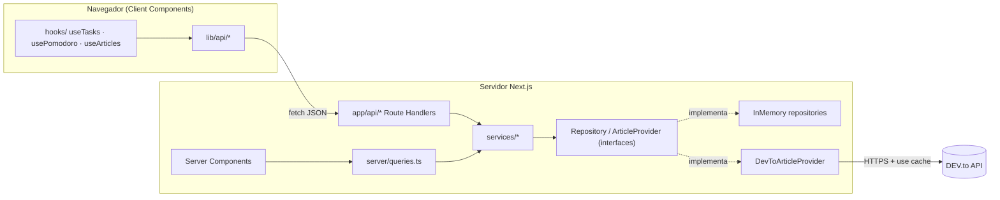

# FocusFlow — Hub de Productividad para Desarrolladores

FocusFlow es un panel de productividad para desarrolladores: gestiona tareas, trabaja en bloques **Pomodoro**, mide tu progreso y descubre artículos técnicos en tiempo real desde la API pública de **DEV.to**.

> 🌐 **Demo en producción:** _pendiente de despliegue — añade aquí la URL de Vercel_ (`https://<tu-proyecto>.vercel.app`)

---

## 🧰 Tecnologías utilizadas

<p align="left">
  
</p>


| Tecnología | Uso |
| --- | --- |
| **Next.js 16** (App Router, Cache Components) | Rutas, Server Components, Route Handlers, streaming con Suspense |
| **React 19** | Client Components, hooks (`useState`, `useEffect`, `useSyncExternalStore`, `useTransition`, `useDeferredValue`) |
| **TypeScript 5** | Tipado estricto de dominio, API y componentes |
| **Tailwind CSS 4** | Sistema de diseño con tokens pastel definidos en `@theme` |
| **Lucide React** | Iconografía |
| **DEV.to API** | Fuente externa de artículos técnicos |

---

## ✨ Funcionalidades

| Ruta | Tipo | Descripción |
| --- | --- | --- |
| `/` | Server + Client | Dashboard: KPIs, gráfica semanal, próximas tareas, alta rápida de tareas y lecturas recomendadas. |
| `/tasks` | Client | CRUD de tareas con filtros, actualizaciones optimistas y temporizador Pomodoro que registra sesiones. |
| `/explore` | Server + Client | Carga inicial en servidor + cambio de etiqueta y búsqueda en cliente contra `/api/articles`. |
| `/analytics` | Server + Client | Métricas de productividad, distribución por categoría y meta diaria persistida en el navegador. |

Además: `loading.tsx` (skeletons), `error.tsx` y `global-error.tsx` (error UI con reintento), `not-found.tsx` (404) y diseño responsive con menú móvil.

---

## 🚀 Instalación y uso

**Requisitos:** Node.js 20.9+ y npm.

```bash
# 1. Clonar el repositorio
git clone https://github.com/<tu-usuario>/focusflow.git
cd focusflow

# 2. Instalar dependencias
npm install

# 3. Configurar variables de entorno
cp .env.example .env.local

# 4. Arrancar en desarrollo
npm run dev            # http://localhost:3000
```

### Scripts

| Script | Descripción |
| --- | --- |
| `npm run dev` | Servidor de desarrollo |
| `npm run build` | Build de producción |
| `npm run start` | Sirve el build de producción |
| `npm run lint` | ESLint (reglas de Next.js + React Hooks) |
| `npm run typecheck` | Comprobación de tipos con `tsc --noEmit` |

### Variables de entorno

Documentadas en [`.env.example`](./.env.example):

| Variable | Requerida | Por defecto | Descripción |
| --- | --- | --- | --- |
| `NEXT_PUBLIC_APP_NAME` | No | `FocusFlow` | Nombre visible de la app |
| `DEVTO_API_URL` | No | `https://dev.to/api` | URL base de la API de DEV.to (solo servidor) |
| `DEVTO_API_KEY` | No | — | Clave opcional de DEV.to (nunca se expone al cliente) |
| `DEVTO_ARTICLES_PER_PAGE` | No | `12` | Artículos por petición (1–30) |
| `DEVTO_CACHE_SECONDS` | No | `600` | Tiempo de caché de las respuestas de DEV.to (60–86400) |

---

## 🏗️ Arquitectura

El proyecto sigue una **arquitectura por capas** (inspirada en Clean/Hexagonal Architecture) en la que las dependencias siempre apuntan hacia el dominio:

```text
src/
├── domain/            # Modelos, reglas puras y errores. Sin dependencias de framework.
├── server/            # Solo servidor (protegido con `server-only`)
│   ├── repositories/  # Puertos (interfaces) + adaptadores en memoria
│   ├── providers/     # Puerto ArticleProvider + adaptador DEV.to (anti-corruption layer)
│   ├── services/      # Casos de uso: TaskService, FocusSessionService, StatsService, ArticleService
│   ├── validation/    # Parseo y validación de entradas HTTP
│   ├── http/          # Envelope de respuesta y mapeo de errores → status HTTP
│   ├── config/        # Variables de entorno tipadas
│   ├── container.ts   # Composition root (inyección de dependencias)
│   └── queries.ts     # Lecturas para Server Components
├── lib/               # Utilidades compartidas y clientes HTTP del navegador
├── hooks/             # Hooks de cliente (estado + efectos)
├── components/        # UI: primitivas (ui/), layout/ y componentes por funcionalidad
├── config/            # Navegación y metadatos del sitio
└── app/               # Rutas del App Router y Route Handlers
```



### Principios SOLID aplicados

| Principio | Dónde se aplica |
| --- | --- |
| **S** — Responsabilidad única | Validadores, servicios, repositorios, mapeadores y componentes tienen una sola razón de cambio. Ej.: `TaskManager` solo orquesta; `TaskList`, `TaskItem`, `TaskForm` y `PomodoroTimer` solo presentan. |
| **O** — Abierto/Cerrado | Variantes y tonos de UI se definen en mapas (`VARIANTS`, `TONE_SOFT`); el menú se amplía añadiendo entradas a `NAV_ITEMS`; los códigos de error se mapean en `STATUS_BY_CODE`. |
| **L** — Sustitución de Liskov | `InMemoryTaskRepository` y cualquier adaptador futuro (p. ej. Supabase) cumplen el mismo contrato asíncrono `TaskRepository`. |
| **I** — Segregación de interfaces | Puertos pequeños y específicos: `TaskRepository`, `FocusSessionRepository`, `ArticleProvider`, `Clock`, `IdGenerator`. |
| **D** — Inversión de dependencias | Los servicios dependen de abstracciones inyectadas por constructor; solo `container.ts` conoce las implementaciones concretas. |

### Patrones de diseño

- **Repository** — abstrae la persistencia (`server/repositories`).
- **Adapter / Anti-Corruption Layer** — `DevToArticleProvider` + `mapDevToArticle` traducen el esquema de DEV.to al modelo de dominio.
- **Composition Root / Dependency Injection** — `server/container.ts`.
- **Service Layer** — casos de uso independientes de HTTP.
- **Higher-Order Function** — `withErrorHandling` elimina el `try/catch` repetido en cada Route Handler.
- **Backend for Frontend (proxy)** — `/api/articles` oculta la URL y la clave de DEV.to y normaliza la respuesta.
- **Container / Presentational components** y **custom hooks** para separar estado de presentación.
- **Optimistic UI** con rollback en `useTasks`.

### API interna

Todas las respuestas usan el mismo envelope: `{ "data": ... }` o `{ "error": { "code", "message", "issues?" } }`.

| Método | Endpoint | Descripción |
| --- | --- | --- |
| `GET` | `/api/tasks?status=&category=&priority=&search=` | Lista tareas filtradas y ordenadas |
| `POST` | `/api/tasks` | Crea una tarea `{ title, description?, category, priority }` |
| `GET` | `/api/tasks/:id` | Obtiene una tarea |
| `PATCH` | `/api/tasks/:id` | Actualiza campos parciales |
| `DELETE` | `/api/tasks/:id` | Elimina una tarea (204) |
| `GET` / `POST` | `/api/sessions` | Lista / registra sesiones Pomodoro `{ taskId?, durationMinutes }` |
| `GET` | `/api/stats` | Métricas agregadas de productividad |
| `GET` | `/api/articles?tag=&perPage=` | Artículos de DEV.to (cacheados en servidor) |

Códigos de error: `400 VALIDATION_ERROR`, `404 NOT_FOUND`, `502 EXTERNAL_SERVICE_ERROR`, `500 INTERNAL_ERROR`.

> ℹ️ **Persistencia:** los datos se guardan en memoria (con datos de ejemplo relativos a la fecha actual). En Vercel cada instancia serverless tiene su propia memoria, así que los cambios no son permanentes. Para persistencia real basta con crear un `SupabaseTaskRepository` que implemente `TaskRepository` y registrarlo en `container.ts`; no hay que tocar servicios, rutas ni UI.

---

## 🎨 Sistema de diseño

- Tipografía: `Arial, Helvetica, sans-serif`.
- Paleta pastel definida como tokens en `src/app/globals.css` (`@theme`): azul sereno `#7C9CBF`, verde salvia `#84A98C`, lavanda `#B8A9C9`, coral `#FDE2E4`, texto pizarra `#334155` / `#64748B` sobre fondo `#F8FAFC`.

---

## ☁️ Despliegue en Vercel

1. Sube el repositorio a GitHub.
2. En [vercel.com/new](https://vercel.com/new) importa el repositorio (Vercel detecta Next.js automáticamente).
3. Añade las variables de `.env.example` en **Settings → Environment Variables** (todas tienen valores por defecto, así que son opcionales).
4. Despliega y actualiza el enlace de la demo al inicio de este README.

---

## 📓 Proceso de Vibe Coding

El registro de prompts, iteraciones, decisiones técnicas y desafíos está en [`VIBE_CODING.md`](./VIBE_CODING.md).
