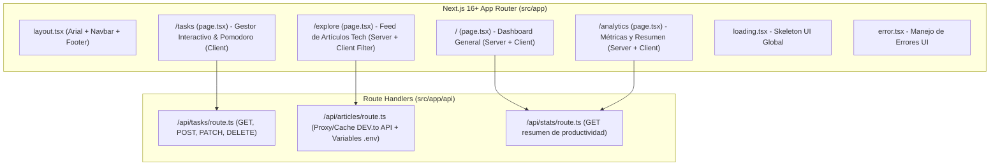

# Plan de Implementación: Aplicación Next.js 16+ mediante Vibe Coding

Este plan detalla la arquitectura, diseño visual, rutas, componentes y entregables para cumplir al 100% con los requisitos establecidos en `context.md`.

> **Propuesta de Temática: "FocusFlow — Hub de Productividad, Hábitos y Recursos Tech"**
> Como la temática en `context.md` es libre, se propone **FocusFlow**: un panel interactivo de bienestar y productividad para desarrolladores que combina gestión de tareas/hábitos, exploración de artículos técnicos en tiempo real (consumiendo la API pública de **DEV.to** + API interna mediante **Next.js Route Handlers**), temporizador Pomodoro y analíticas de enfoque. *(Si prefieres otra temática como E-commerce, Clima/Viajes o Finanzas, podemos adaptarla antes de iniciar).*

---

## 1. Identidad Visual y Sistema de Diseño

Siguiendo las especificaciones de estilo solicitadas:

* **Tipografía Principal**: `Arial, Helvetica, sans-serif` configurada globalmente en `src/app/globals.css` y en la configuración de Tailwind CSS (`font-sans`).
* **Paleta de Colores (Tonalidades Suaves / Pastel)**:
  * **Fondo Principal (`#F8FAFC` / `#F4F6F8`)**: Gris azulado ultra suave para evitar fatiga visual.
  * **Superficies y Tarjetas (`#FFFFFF` / `#EEF2F6`)**: Blanco puro con bordes suaves (`#E2E8F0`).
  * **Primario Suave — Azul Sereno (`#7C9CBF` / `#DBEAFE`)**: Para acciones principales y navegación activa.
  * **Secundario Suave — Verde Salvia (`#84A98C` / `#DCFCE7`)**: Para estados completados, hábitos y métricas positivas.
  * **Acento Cálido — Lavanda / Coral Pastel (`#B8A9C9` / `#FDE2E4`)**: Para etiquetas, alertas suaves y tarjetas destacadas.
  * **Texto (`#334155` principal / `#64748B` secundario)**: Gris pizarra suave en lugar de negro puro para mantener armonía visual.

---

## 2. Stack Tecnológico e Iconos en `README.md`

En el archivo `README.md` ubicaremos una sección destacada de **Tecnologías Utilizadas** con iconos y badges visuales (mediante *Skill Icons* y *Shields.io*):

* **Next.js 16+** (App Router)
* **React 19** (Server & Client Components)
* **TypeScript 5**
* **Tailwind CSS 4**
* **Lucide React** (Iconografía minimalista de interfaz)
* **Git & GitHub** + **Vercel** (Control de versiones y Despliegue)

Vista previa de los iconos que se incluirán en el `README.md`:

```markdown
<p align="left">
  
</p>
```

---

## 3. Arquitectura de la Aplicación (Next.js App Router)



### Rutas y Páginas (Mínimo 4 rutas requeridas)
1. **`/` (Inicio / Dashboard)**:
   * **Server Component** que carga el resumen inicial de estadísticas y recursos destacados.
   * Incorpora widgets interactivos (**Client Components**) de acceso rápido.
2. **`/tasks` (Tablero de Enfoque y Tareas)**:
   * **Client Component** con `useState` y `useEffect` para creación, filtrado por categoría/prioridad, persistencia vía API interna (`/api/tasks`) y temporizador Pomodoro de sesiones de enfoque.
3. **`/explore` (Explorador de Recursos para Desarrolladores)**:
   * Combina **Server Component** (carga inicial) y **Client Component** (búsqueda dinámica por etiquetas como `nextjs`, `typescript`, `ai` usando `useState` y `useEffect`) consumiendo el **Route Handler** `/api/articles` conectado a la API externa de DEV.to.
4. **`/analytics` (Métricas y Progreso)**:
   * Visualización con tarjetas y barras de progreso en tonos pastel suaves, distribución de tiempo por categoría y racha semanal de hábitos.

### Estados de Carga y Error
* **`src/app/loading.tsx`**: Esqueletos de carga animados (`animate-pulse`) con colores pastel suaves mientras se resuelven las promesas de Server Components.
* **`src/app/error.tsx`**: Interfaz amigable de captura de errores en tiempo de ejecución (`'use client'`) con botón de recuperación (`reset()`).
* **`src/app/not-found.tsx`**: Página 404 personalizada siguiendo la estética suave y fuente Arial.

---

## 4. Estructura de Archivos del Proyecto

```text
vibecodingProject/
├── .env.example                 # Plantilla documentada de variables de entorno
├── .env.local                   # Variables activas (API URLs, configuración)
├── implementacion.md            # Este documento de plan de implementación
├── README.md                    # Documentación completa + Iconos de tecnologías + Link de despliegue
├── VIBE_CODING.md               # Registro detallado de prompts, iteraciones, decisiones y retos superados
├── package.json                 # Next.js 16+, React, TypeScript, Tailwind CSS
├── tsconfig.json
└── src/
    ├── types/
    │   └── index.ts             # Interfaces TypeScript (Task, Article, Stats, ApiResponse)
    ├── lib/
    │   └── data.ts              # Almacén de datos iniciales y utilidades de fetch
    ├── components/
    │   ├── Navbar.tsx           # Navegación responsive móvil/escritorio (Client Component)
    │   ├── Footer.tsx           # Pie de página (Server Component)
    │   ├── TaskManager.tsx      # CRUD de tareas con useState y useEffect (Client Component)
    │   ├── PomodoroTimer.tsx    # Temporizador de enfoque con hooks (Client Component)
    │   └── ArticleExplorer.tsx  # Buscador interactivo de artículos (Client Component)
    └── app/
        ├── globals.css          # Configuración de fuente Arial y variables de colores suaves
        ├── layout.tsx           # Layout raíz y metadatos SEO
        ├── loading.tsx          # Estado de carga global (Loading UI)
        ├── error.tsx            # Manejo de errores global (Error UI)
        ├── not-found.tsx        # Página 404 personalizada
        ├── page.tsx             # Ruta 1: Dashboard principal
        ├── tasks/
        │   └── page.tsx         # Ruta 2: Gestor de tareas y Pomodoro
        ├── explore/
        │   └── page.tsx         # Ruta 3: Explorador de artículos vía API
        ├── analytics/
        │   └── page.tsx         # Ruta 4: Estadísticas y progreso
        └── api/
            ├── tasks/
            │   └── route.ts     # Route Handler interno (GET/POST/PATCH/DELETE)
            ├── articles/
            │   └── route.ts     # Route Handler con consumo de API externa (DEV.to)
            └── stats/
                └── route.ts     # Route Handler de métricas agregadas
```

---

## 5. Fases de Ejecución e Historial de Commits (Flujo Vibe Coding)

Para cumplir con el requisito de un **historial de commits descriptivo e iterativo**:

1. **Fase 1 — Inicialización y Configuración Base**
   * Inicializar el repositorio Git y proyecto Next.js 16+ con TypeScript y Tailwind CSS.
   * Configurar tipografía `Arial` y paleta de tonos suaves en `globals.css`.
   * *Commit*: `chore: initialize Next.js 16 TypeScript project with Arial font and soft color palette`
2. **Fase 2 — Arquitectura de Datos y Route Handlers (API)**
   * Crear tipos en `src/types/index.ts`, configuración `.env.local` / `.env.example` y los endpoints `/api/tasks`, `/api/articles` y `/api/stats`.
   * *Commit*: `feat(api): add Next.js route handlers for tasks, stats, and external articles API`
3. **Fase 3 — Layout, Estados Globales (`loading.tsx`, `error.tsx`) y Navegación Responsive**
   * Construir `Navbar`, `Footer`, `loading.tsx`, `error.tsx` y `not-found.tsx`.
   * *Commit*: `feat(ui): implement responsive layout, navigation, loading skeletons, and error boundary`
4. **Fase 4 — Desarrollo de las 4 Páginas y Componentes Server/Client**
   * Implementar `/`, `/tasks`, `/explore` y `/analytics` integrando `useState` y `useEffect`.
   * *Commit*: `feat(pages): build dashboard, tasks, explore, and analytics routes with Server and Client components`
5. **Fase 5 — Documentación (`README.md` con iconos y `VIBE_CODING.md`) y Verificación**
   * Redactar `README.md` (con los iconos de las tecnologías, guía de instalación y arquitectura) y `VIBE_CODING.md` (documentando prompts, iteraciones, decisiones técnicas y resolución de problemas).
   * Ejecutar `npm run build` y pruebas de endpoints para asegurar cero errores de compilación o tipado.
   * *Commit*: `docs: add README with tech stack icons and VIBE_CODING process documentation`
